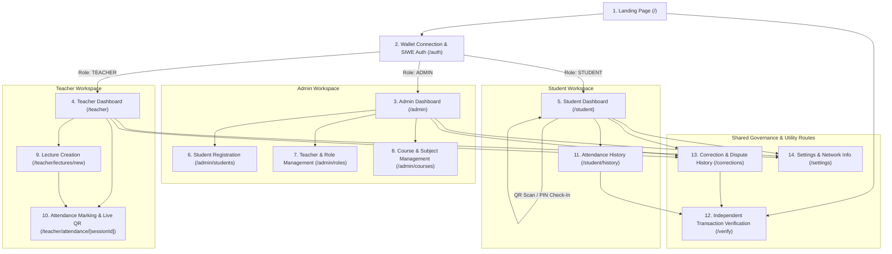

# 03_UIUX.md — UI/UX Design Specification

- **Purpose:** Define the complete visual design system, design tokens, component inventory, Mermaid sitemap and user flows, screen-by-screen specifications for all 14 routes, Web3 failure states, and WCAG 2.2 Level AA accessibility rules for AttendChain.
- **Status:** Draft v1
- **Last updated:** 2026-10-13
- **Depends on:** `/docs/01_PRD.md`, `/docs/02_TRD.md`

---

## 1. Design Principles & Visual Direction

AttendChain follows a **"Modern Academic SaaS with Verifiable Web3 Provenance"** aesthetic (inspired by Linear, Stripe Dashboard, and Canvas LMS):
1. **Academic Clarity First, Web3 Second:** Faculty and students interact primarily with familiar academic constructs (Courses, Lecture Sessions, Roll Numbers, Attendance Percentages). Cryptographic artifacts (`studentIdHash`, `txHash`, block numbers, contract events) are presented in clean monospace pills and expandable verification drawers rather than overwhelming the primary workspace.
2. **Explicit Evidentiary State Separation:** The UI visually distinguishes between **Off-Chain Staged Drafts** (dashed border, amber/neutral pill: `Staged — Not Yet On-Chain`) and **Confirmed On-Chain Records** (solid border, emerald badge with block icon: `Confirmed in Block #7482910`).
3. **Never Block the User Without Context:** Because Sepolia transactions take 12–36 seconds, every write action uses a 4-stage non-blocking progress stepper (`1. Sign in Wallet` $\rightarrow$ `2. Broadcasted to Mempool` $\rightarrow$ `3. Confirmed On-Chain` $\rightarrow$ `4. Indexed & Verified`).
4. **Zero-Jargon Failure Recovery:** Raw RPC revert strings and hexadecimal error codes are translated into human-readable explanations with a single primary recovery button (e.g., `"Switch to Ethereum Sepolia"` or `"Retry Signature"`).

---

## 2. Design Tokens

### 2.1 Color Palette & WCAG 2.2 AA Contrast Verification

| Token Category | Token Name | Tailwind Variable / Class | Hex Value | Usage & Contrast Ratio |
| :--- | :--- | :--- | :--- | :--- |
| **Backgrounds** | `bg-canvas` | `bg-slate-50` | `#F8FAFC` | Primary app background |
| | `bg-surface` | `bg-white` | `#FFFFFF` | Cards, tables, modals, sidebar |
| | `bg-subtle` | `bg-slate-100` | `#F1F5F9` | Table headers, secondary panels, code pills |
| | `bg-projector` | `bg-slate-950` | `#020617` | High-contrast full-screen Teacher Dynamic QR projection mode |
| **Typography** | `text-primary` | `text-slate-900` | `#0F172A` | Headings, body copy (`16.8:1` on `#FFFFFF` — AAA) |
| | `text-secondary` | `text-slate-600` | `#475569` | Labels, metadata, timestamps (`7.5:1` on `#FFFFFF` — AAA) |
| | `text-muted` | `text-slate-500` | `#64748B` | Helper text, disabled captions (`4.7:1` on `#FFFFFF` — AA) |
| **Brand / Primary** | `brand-primary` | `bg-indigo-600` / `text-indigo-600` | `#4F46E5` | Primary CTA buttons, active navigation, focus rings (`6.2:1` with white text — AA) |
| | `brand-hover` | `bg-indigo-700` | `#4338CA` | Primary CTA hover state (`8.1:1` with white text — AAA) |
| | `brand-soft` | `bg-indigo-50` | `#EEF2FF` | Selected row highlight, role badges |
| **Attendance & Chain Status** | `status-present` | `text-emerald-800` on `bg-emerald-50` (`#ECFDF5`) | `#065F46` | `PRESENT` badge, `VERIFIED` state, `>=75%` eligible (`7.8:1` — AAA) |
| | `status-late` | `text-amber-900` on `bg-amber-50` (`#FFFBEB`) | `#78350F` | `LATE` badge, `65%–74.99%` warning zone, `Pending Tx` (`8.4:1` — AAA) |
| | `status-absent` | `text-rose-800` on `bg-rose-50` (`#FFF1F2`) | `#9F1239` | `ABSENT` badge, `<65%` shortage, `Reverted Tx`, `MISMATCH` (`7.1:1` — AAA) |
| | `status-excused` | `text-sky-900` on `bg-sky-50` (`#F0F9FF`) | `#0C4A6E` | `EXCUSED` badge, `Amended` record indicator (`8.9:1` — AAA) |
| | `status-web3` | `text-violet-900` on `bg-violet-50` (`#F5F3FF`) | `#4C1D95` | On-chain event pills, Sepolia network badge (`9.2:1` — AAA) |
| **Borders** | `border-default` | `border-slate-200` | `#E2E8F0` | Card and table dividers |
| | `border-focus` | `ring-indigo-600` | `#4F46E5` | `2px` solid keyboard focus ring with `2px` offset |

### 2.2 Typography Scale

- **Primary UI Font (`--font-sans`):** `Inter`, `-apple-system`, `BlinkMacSystemFont`, `"Segoe UI"`, `sans-serif`.
- **Cryptographic / Technical Font (`--font-mono`):** `"JetBrains Mono"`, `ui-monospace`, `SFMono-Regular`, `monospace` (mandatory for all wallet addresses, `studentIdHash`, `txHash`, block numbers, gas values, and rotating QR PINs).

| Token | Font Size (`rem` / `px`) | Line Height | Font Weight | Letter Spacing | Usage |
| :--- | :--- | :--- | :--- | :--- | :--- |
| `display-qr` | `3.0rem` (`48px`) | `1.1` | `700` (Bold) | `0.08em` | Projector QR 6-char challenge PIN & live countdown |
| `h1` | `1.875rem` (`30px`) | `2.25rem` (`36px`) | `700` (Bold) | `-0.02em` | Page titles |
| `h2` | `1.5rem` (`24px`) | `2.0rem` (`32px`) | `600` (SemiBold) | `-0.015em` | Section headers, modal titles |
| `h3` | `1.125rem` (`18px`) | `1.75rem` (`28px`) | `600` (SemiBold) | `-0.01em` | Card titles, course titles |
| `body-base` | `0.9375rem` (`15px`) | `1.5rem` (`24px`) | `400` (Regular) | `0` | Standard dashboard text, form inputs |
| `body-sm` | `0.8125rem` (`13px`) | `1.25rem` (`20px`) | `500` (Medium) | `0` | Table cells, status badges, secondary captions |
| `mono-code` | `0.8125rem` (`13px`) | `1.25rem` (`20px`) | `500` (Medium) | `0` | Truncated hashes (`0x8a3f...91b2`), block numbers |

### 2.3 Spacing, Radii, Shadows, Breakpoints, and Motion

- **Spacing Scale (`4px` grid):** `space-1` (`4px`), `space-2` (`8px`), `space-3` (`12px`), `space-4` (`16px`), `space-6` (`24px`), `space-8` (`32px`), `space-12` (`48px`), `space-16` (`64px`).
- **Border Radii:** `radius-sm` (`6px` — badges/code pills), `radius-md` (`8px` — buttons/inputs), `radius-lg` (`12px` — cards/tables), `radius-xl` (`16px` — modals/QR display).
- **Elevation Shadows:**
  - `shadow-card`: `0 1px 3px 0 rgba(15, 23, 42, 0.06), 0 1px 2px -1px rgba(15, 23, 42, 0.04)`
  - `shadow-modal`: `0 20px 25px -5px rgba(15, 23, 42, 0.12), 0 8px 10px -6px rgba(15, 23, 42, 0.08)`
- **Responsive Breakpoints:**
  - `sm`: `640px` (Mobile landscape / large phone)
  - `md`: `768px` (Tablet — collapsible sidebar becomes drawer)
  - `lg`: `1024px` (Desktop — persistent `260px` left sidebar)
  - `xl`: `1280px` (Wide desktop — 12-column grid, max container `1440px`)
- **Motion & `prefers-reduced-motion`:**
  - Micro-interactions (hover, badge state change): `150ms cubic-bezier(0.16, 1, 0.3, 1)`
  - Drawers and modals: `220ms cubic-bezier(0.16, 1, 0.3, 1)`
  - **Reduced Motion Rule:** When `@media (prefers-reduced-motion: reduce)` is active, all CSS transitions and animations (including transaction pulse spinners and QR countdown progress bars) collapse to `0.01ms` instant state changes (`NFR-006`).

---

## 3. Component Inventory & Interactive States

Every reusable component in `src/components/` must implement all 7 states listed below:

| Component | Variants | Default | Hover | Focus (Keyboard) | Disabled | Loading | Error | Empty |
| :--- | :--- | :--- | :--- | :--- | :--- | :--- | :--- | :--- |
| **`Button`** | `primary`, `secondary`, `danger`, `ghost`, `web3-tx` | Solid fill or bordered surface | `-1px` subtle lift or darker shade | `2px` `#4F46E5` ring + `2px` offset | `opacity-50`, `cursor-not-allowed`, `aria-disabled="true"` | Inline spinner + action label (`"Signing in MetaMask..."`) | Rose border + shake (`0ms` if reduced-motion) | N/A |
| **`WalletStatusPill`** | `disconnected`, `connected-unverified`, `authenticated`, `wrong-network` | Shows checksummed address + role badge | Shows copy/disconnect tooltip | `2px` indigo ring | Disabled during active signature prompt | Pulsing amber dot (`"Verifying SIWE..."`) | Red pill (`"Wrong Network: Switch to Sepolia"`) | `"No Wallet Connected"` |
| **`AttendanceStatusSelector`** | Segmented radio group: `PRESENT`, `LATE`, `ABSENT`, `EXCUSED` | Active status pill highlighted with icon | Light background tint on unselected segments | Arrow-key roving tabindex + focus ring | Locked with lock icon when session is `CLOSED` | Skeleton shimmer while roster loads | Highlights row in rose if invalid | Defaults to `ABSENT` on batch commit preview |
| **`PercentageGaugeCard`** | `eligible` ($\ge 75\%$), `warning` ($65\text{--}74.99\%$), `shortage` ($<65\%$), `na` ($0$ sessions) | Displays `%` to 2 decimals + numerator/denominator fraction | Highlights breakdown tooltip (`Present`, `Late`, `Excused`, `Absent`) | Focusable card header link to course history | N/A | Skeleton bar + numeric placeholder | Displays `"Calculation Sync Error — Retry"` | Displays `100.00%` with badge `"N/A (0 Eligible Sessions)"` |
| **`DynamicQrProjector`** | `standard-card`, `fullscreen-projector` | Crisp SVG QR + 30s countdown ring + 6-char challenge PIN | Shows `"Copy Check-In Link"` button | Escape key exits fullscreen; buttons focusable | Disabled if session status $\neq$ `OPEN` | `"Generating fresh 30s cryptographic challenge..."` | `"QR Rotation Failed — Click to Regenerate"` | `"Activate QR Mode to allow student check-ins"` |
| **`TxLifecycleBanner`** | `awaiting-signature`, `pending-confirm`, `confirmed`, `reverted` | Stepper showing current stage + `txHash` mono link | Underlines Etherscan link | Focuses recovery button on revert | N/A | Animated progress bar during `pending-confirm` | Red alert box with decoded Solidity custom error | Hidden when no active transaction |
| **`VerificationDiffCard`** | `verified-match`, `integrity-mismatch`, `tx-not-found` | Side-by-side table: `Off-Chain DB` vs `On-Chain Sepolia RPC` | Highlights matching fields (`status`, `studentIdHash`, `timestamp`) | Tab through `Copy Hash` and `View on Etherscan` | N/A | `"Querying Ethereum Sepolia RPC & Decoding Logs..."` | High-priority red banner: `"DATA INTEGRITY MISMATCH DETECTED"` | `"Enter a Transaction Hash or Select a Session Record to Verify"` |

---

## 4. Sitemap & User Flow Diagrams

### 4.1 Complete Route Sitemap (14 Approved Screens)

### 4.2 User Flow Diagram: Teacher Session Creation, Hybrid QR + Batch Attendance & Verification

```mermaid
flowchart LR
    T1["Teacher Opens /teacher/lectures/new"] --> T2["Signs openSession() Tx in MetaMask"]
    T2 --> T3["Session OPEN (/teacher/attendance/[sessionId])"]
    T3 --> QR["Teacher Enables 30s Rotating QR"]
    T3 --> Manual["Teacher Toggles Present/Late/Absent/Excused"]
    QR --> SScan["Student Scans QR or Enters 6-Char PIN"]
    SScan --> SSign["Student Signs Free Wallet Check-In OR Submits EIP-712 checkInWithTicket()"]
    SSign --> Roster["Live Roster Shows 'PRESENT (QR Verified)'"]
    Manual --> Roster
    Roster --> Batch["Teacher Clicks 'Commit Batch & Close Session'"]
    Batch --> Tx["Signs recordBatchAttendance() Tx"]
    Tx --> Confirmed["Confirmed on Sepolia -> Session CLOSED"]
    Confirmed --> Verifier["Any User Verifies Tx on /verify against Sepolia RPC"]
```

---

## 5. Screen-by-Screen Specifications (14 Routes)

### Screen 1: Landing Page
- **Route:** `/`
- **Linked Requirements:** `FR-001`, `FR-014`, `NFR-006`
- **Authorized Roles:** Public (Unauthenticated & Authenticated users)
- **Purpose:** Introduce AttendChain's value proposition, clearly explain the evidentiary boundary (tamper-evident on-chain audit trail + zero on-chain PII), and provide immediate entry to Wallet Authentication (`/auth`) or Public Transaction Verification (`/verify`).
- **Layout & Components:** Top navigation bar (`AttendChain` brand mark, network indicator pill, `"Verify a Transaction"` link, `"Connect & Sign In"` primary button), 2-column Hero section with interactive architecture preview card, and a 3-card feature grid (`Zero On-Chain PII via Salted Hashes`, `Gas-Efficient Batch & Dynamic QR Roll Call`, `Immutable Correction Audit Trail`).
- **Realistic UI Copy:**
  - *Hero Headline:* `"Tamper-Evident Classroom Attendance on Ethereum Sepolia — Without Exposing Student Privacy."`
  - *Disclaimers Banner:* `"Cryptographic Provenance Notice: AttendChain proves which authorized faculty or student wallet submitted attendance within a lecture window and records every subsequent amendment on-chain. Student names and roll numbers remain strictly off-chain."`
- **Validation & States:** If user already holds a valid SIWE session cookie, primary CTA displays `"Go to My Dashboard (/admin | /teacher | /student)"`.
- **Responsive Behaviour:** 2-column hero stacks vertically below `lg` (`1024px`).

### Screen 2: Wallet Connection & SIWE Authentication
- **Route:** `/auth`
- **Linked Requirements:** `FR-001`, `FR-002`, `FR-006`, `FR-021`, `NFR-005`
- **Authorized Roles:** Public entry; transitions user to `ADMIN`, `TEACHER`, or `STUDENT` session.
- **Purpose:** Enforce a strict 2-step authentication flow: (Step 1) EIP-1193 Wallet Connection & Network Check, followed by (Step 2) EIP-4361 Sign-In with Ethereum (SIWE) cryptographic nonce verification. Also allows first-time students to bind their wallet using their synthetic student invitation code.
- **Layout & Components:** Centered `480px` authentication card with a 2-step visual indicator (`Step 1: Connect Wallet` $\rightarrow$ `Step 2: Verify Ownership Signature`), Network Status Pill, and a collapsible `"First-Time Student? Bind Your Roll Number Hash"` accordion.
- **Realistic UI Copy:**
  - *Step 1 Button:* `"Connect MetaMask Wallet"`
  - *Step 2 Explanation:* `"Wallet connected (0x71C...89A). Connecting a wallet alone does not verify ownership. Please sign the free, gasless authentication challenge in MetaMask to continue."`
  - *Step 2 Button:* `"Sign Authentication Challenge (Zero Gas)"`
- **Validation & States:**
  - *Loading:* `"Awaiting signature in MetaMask... Please check your wallet extension."`
  - *Error (Signature Rejected):* `"Signature request was cancelled. You must sign the challenge to prove ownership of 0x71C...89A."`
  - *Error (Unregistered Wallet):* `"This wallet is not yet linked to an Admin, Teacher, or Student profile. Enter a synthetic Student Claim Code below or contact the Academic Admin."`

### Screen 3: Admin Dashboard
- **Route:** `/admin`
- **Linked Requirements:** `FR-003`, `FR-004`, `FR-005`, `FR-007`, `FR-020`
- **Authorized Roles:** `ADMIN`
- **Purpose:** Institutional command center displaying system-wide metrics, shortage alerts (`<75%`), recent on-chain contract events, and quick actions for student registration, teacher role grants, and course creation.
- **Layout & Components:** Persistent left sidebar (`260px` on desktop), top header with `WalletStatusPill` and `Sync Chain Events` button, 4 KPI summary cards (`Total Registered Students`, `Active Courses`, `Verified On-Chain Sessions`, `Students Below 75% Threshold`), a `Shortage Alert Table` with `"Export Shortage CSV"` button (`FR-020`), and a `Recent Blockchain Audit Feed`.
- **Realistic UI Copy:**
  - *KPI Card 4:* `"Attendance Shortage Alerts (<75.00%): 4 Students require academic review."`
  - *Audit Feed Item:* `"Block #7482910 • AttendanceCorrected in CS701 (Session #12) by 0x4B2...19C • Tx: 0x9f1a...3c4d"`
- **Validation & States:**
  - *Empty State:* `"No courses or students registered yet. Start by granting a Teacher Role or seeding the synthetic demo cohort."`
  - *Loading:* 4 KPI skeleton cards + table row shimmer.

### Screen 4: Teacher Dashboard
- **Route:** `/teacher`
- **Linked Requirements:** `FR-008`, `FR-010`, `FR-013`, `FR-020`
- **Authorized Roles:** `TEACHER`, `ADMIN`
- **Purpose:** Provide faculty with an immediate overview of their assigned courses, active (`OPEN`) lecture sessions requiring attendance submission, recent completed sessions, and course-level shortage summaries.
- **Layout & Components:** Active Session Banner (if any session is currently `OPEN`, highlighted in indigo with `"Resume Live Roll Call / QR"` button), Assigned Courses Grid (showing enrolled count, completed sessions count, average attendance %, and `"Start New Lecture Session"` CTA), and Recent Sessions Table.
- **Realistic UI Copy:**
  - *Active Banner:* `"LIVE SESSION OPEN: CS701 — Lecture #15 (Consensus Mechanisms). 18/30 students staged via QR. Commit to blockchain before closing."`
- **Validation & States:**
  - *Empty State:* `"No courses are currently assigned to your teacher wallet (0x4B2...19C). Ask an Administrator to assign you to a course on /admin/courses."`

### Screen 5: Student Dashboard
- **Route:** `/student`
- **Linked Requirements:** `FR-012`, `FR-013`, `FR-018`, `FR-019`
- **Authorized Roles:** `STUDENT`
- **Purpose:** Give the student immediate visibility into their overall and subject-wise attendance percentages against the 75% threshold, plus a prominent **"Check In to Live Lecture (QR / Session PIN)"** card when one of their enrolled courses has an `OPEN` session.
- **Layout & Components:** Overall Eligibility Banner (`Eligible >= 75%`, `Warning 65–74.99%`, or `Shortage < 65%`), Live Lecture Check-In Card (camera QR scanner / 6-character rotating session PIN input + `"Sign & Check In"` button + optional `"Submit Directly On-Chain (EIP-712)"` secondary action), Subject-Wise `PercentageGaugeCard` grid, and Pseudonymous Identity Badge showing the student's `studentIdHash` (`0x3e9b...f012`) with privacy tooltip.
- **Realistic UI Copy:**
  - *Privacy Callout:* `"Your Roll Number (SYN-2026-042) is stored strictly off-chain. On Ethereum Sepolia, your attendance is indexed under pseudonymous commitment 0x3e9b...f012."`
  - *Percentage Card:* `"CS701 — Blockchain Architecture: 85.71% (12 Present / 14 Eligible Completed Sessions) • Status: Regular (>=75%)"`

### Screen 6: Student Registration & Cohort Enrollment
- **Route:** `/admin/students`
- **Linked Requirements:** `FR-005`, `FR-006`, `FR-007`, `NFR-001`
- **Authorized Roles:** `ADMIN`
- **Purpose:** Register synthetic student records off-chain, preview the deterministic salted `studentIdHash` (`bytes32`), optionally associate a student MetaMask wallet address, and batch-enroll `studentIdHash` commitments into courses on-chain (`enrollStudentsBatch`).
- **Layout & Components:** Split view or tabbed interface: (1) `"Register Synthetic Student / Batch CSV Import"` form, (2) Live `studentIdHash` cryptographic preview box demonstrating that only the `bytes32` hash goes on-chain, and (3) Registered Students Table showing `Synthetic Name`, `Roll Number (SYN-*)`, `studentIdHash`, `Bound Wallet Status (Linked / Pending Wallet)`, `Enrolled Courses`, and `"Commit On-Chain Enrollment"` batch action bar.
- **Validation & States:**
  - Roll number must match synthetic format (`^SYN-[A-Z0-9-]+$`) to prevent accidental entry of real student roll numbers (`Non-Negotiable Principle #8 & #9`).
  - Optional wallet address validated via `ethers.isAddress`.

### Screen 7: Teacher & Role Management
- **Route:** `/admin/roles`
- **Linked Requirements:** `FR-003`, `FR-004`
- **Authorized Roles:** `ADMIN`
- **Purpose:** Grant and revoke `TEACHER_ROLE` and `ADMIN_ROLE` on the `AttendChainRegistry` smart contract and view role assignment transaction history.
- **Layout & Components:** `"Grant Role"` form (`Wallet Address`, `Synthetic Faculty Name`, `Department`, `Role Selector: TEACHER_ROLE | DEFAULT_ADMIN_ROLE`, `"Grant Role On-Chain"` button) and Active Role Holders Table with `"Revoke Role"` action and confirmation modal.
- **Validation & States:**
  - Validates checksummed Ethereum address (`ethers.getAddress`); prevents self-revocation of the last remaining Admin account.

### Screen 8: Course & Subject Management
- **Route:** `/admin/courses`
- **Linked Requirements:** `FR-007`
- **Authorized Roles:** `ADMIN`
- **Purpose:** Create academic courses (`CS701`, `CS702`, etc.), compute `courseIdHash`, assign a wallet holding `TEACHER_ROLE`, and manage course student enrollments on-chain.
- **Layout & Components:** `"Create Course"` card (`Course Code`, `Course Title`, `Semester`, `Assigned Teacher Dropdown` filtered to active `TEACHER_ROLE` wallets) + Courses Table displaying on-chain `courseIdHash`, assigned teacher, enrolled student count, total sessions, and `"Manage Enrolled Students"` drawer.
- **Validation & States:** Cannot submit `createCourse` unless selected teacher holds `TEACHER_ROLE` on-chain.

### Screen 9: Lecture Session Creation
- **Route:** `/teacher/lectures/new`
- **Linked Requirements:** `FR-008`
- **Authorized Roles:** `TEACHER`, `ADMIN`
- **Purpose:** Open a new verifiable lecture session on-chain (`openSession`) for an assigned course and immediately transition to attendance marking / QR display.
- **Layout & Components:** Focused single-column form (`640px` max width): `Course Selector` (filtered to teacher's assigned courses), `Lecture Topic / Title` (stored off-chain, hashed into `bytes32 metadataHash` on-chain), `Scheduled Start Time`, `Session Window Duration` (`30 min`, `50 min`, `90 min`, `120 min`), `Initial Roll Call Mode` (`Hybrid QR + Manual Roster` or `Manual Roster Only`), and `"Open Session On-Chain"` primary Web3 CTA.
- **Validation & States:** `endTime` must be strictly greater than `startTime` (`>= 15 minutes`). Upon confirmation of `SessionOpened`, automatically routes to `/teacher/attendance/[sessionId]`.

### Screen 10: Attendance Marking & Dynamic QR Live Session
- **Route:** `/teacher/attendance/[sessionId]`
- **Linked Requirements:** `FR-009`, `FR-010`, `FR-011`, `FR-018`, `FR-019`
- **Authorized Roles:** `TEACHER` (assigned to course), `ADMIN`
- **Purpose:** Primary classroom workspace allowing the teacher to project a 30-second rotating QR code, watch live verified student check-ins arrive in real time, manually mark or override any student's status (`PRESENT`, `LATE`, `ABSENT`, `EXCUSED`), and commit the entire class roster in a single gas-efficient `recordBatchAttendance` transaction.
- **Layout & Components:**
  - **Top Session Control Bar:** Session badge (`Session #15 • OPEN`), Course code, live counter (`18 Present • 2 Late • 1 Excused • 9 Unmarked`), `"Project Live QR Code"` toggle button, `"Cancel Session"` secondary danger button, and `"Commit Batch Attendance & Close Session (30 Students)"` primary Web3 CTA.
  - **Collapsible / Fullscreen Dynamic QR Panel (`DynamicQrProjector`):** Displays high-contrast SVG QR code, 30-second circular progress countdown, 6-character rotating session PIN (`e.g., K9M-4P2`) for desktop/laptop student check-in, and late-window toggle (`Mark QR scans as LATE`).
  - **Interactive Roster Table:** Lists all enrolled students (`Roll Number`, `Synthetic Name`, `Pseudonymous Hash`, `Check-In Source: QR Verified | Manual | Unmarked`, and 4-segment `AttendanceStatusSelector`). Includes bulk quick-actions: `"Mark All Remaining as Absent"` and `"Mark All as Present"`.
- **Realistic UI Copy:**
  - *Batch Commit Confirmation Modal:* `"You are committing 30 attendance records for CS701 (Session #15) to Ethereum Sepolia and closing the session. Unmarked students (2) will be recorded as ABSENT. Estimated gas: ~890,000 gas (1 transaction)."`
- **Validation & States:** If session is already `CLOSED` or `CANCELLED`, status selectors become read-only with a banner linking to `/corrections` for post-closure audited amendments.

### Screen 11: Student Attendance History
- **Route:** `/student/history`
- **Linked Requirements:** `FR-012`, `FR-013`, `FR-014`, `FR-015`, `FR-017`
- **Authorized Roles:** `STUDENT` (also viewable per-student by `TEACHER`/`ADMIN`)
- **Purpose:** Chronological, filterable ledger of all lecture sessions across a student's enrolled courses, showing effective status, amendment indicators, and direct verification links.
- **Layout & Components:** Filter bar (`Course Dropdown`, `Status Filter: All | PRESENT | LATE | ABSENT | EXCUSED`, `Amended Only Toggle`), Summary Strip showing filtered numerator/denominator impact, and Session History Table (`Session # & Date`, `Course & Topic`, `Effective Status Badge`, `Check-In Method`, `On-Chain Tx Hash`, `"Verify On-Chain"` button, and `"Request Correction / Dispute"` button).
- **Validation & States:**
  - Clicking `"Verify On-Chain"` opens `/verify?session=[id]&student=[hash]&tx=[txHash]`.
  - Clicking `"Request Correction"` opens a modal to submit an off-chain dispute note for a `CLOSED` session (`FR-017`).

### Screen 12: Independent Transaction Verification
- **Route:** `/verify`
- **Linked Requirements:** `FR-014`, `FR-015`
- **Authorized Roles:** Public (Any Student, Teacher, Admin, or external Academic Evaluator)
- **Purpose:** Allow anyone to independently verify that an attendance record displayed in AttendChain matches the immutable state stored in `AttendChainRegistry` on Ethereum Sepolia / Hardhat RPC.
- **Layout & Components:**
  - **Query Input Bar:** `Transaction Hash (0x...)`, `Session ID`, and `Student Pseudonymous Hash (bytes32)` (auto-filled when navigated from a history row), plus `"Verify Directly Against Blockchain RPC"` button.
  - **Cryptographic Verification Result Banner:** Large emerald banner (`CRYPTOGRAPHICALLY VERIFIED — 100% Match Between Application Record and Blockchain State`) or rose alert (`DATA INTEGRITY MISMATCH — Off-Chain Database Differs From Smart Contract`).
  - **Side-by-Side Comparison Table (`VerificationDiffCard`):** Compares `Effective Status`, `Student Commitment (bytes32)`, `Recorded Timestamp`, `Amendment Count`, `Last Signer Wallet`, and `Block Number` between **Off-Chain Supabase Cache** and **Live RPC Smart Contract Storage (`getAttendanceRecord`)**.
  - **Decoded Event Log Timeline:** Displays raw and decoded `AttendanceRecorded` and `AttendanceCorrected` logs fetched from `eth_getTransactionReceipt` with a direct `"View on Sepolia Etherscan"` button.

### Screen 13: Correction & Dispute History
- **Route:** `/corrections`
- **Linked Requirements:** `FR-015`, `FR-016`, `FR-017`
- **Authorized Roles:** `ADMIN`, `TEACHER` (write + view); `STUDENT` (view own + submit dispute request)
- **Purpose:** Provide a dedicated governance workflow for reviewing student attendance disputes and executing auditable on-chain corrections (`correctAttendance`) on closed sessions while displaying the permanent before/after audit trail.
- **Layout & Components:**
  - **Teacher/Admin `"Execute On-Chain Correction"` Panel:** Select `Course`, `Closed Session`, and `Enrolled Student`; displays `Current On-Chain Status` (read-only), `New Status Selector`, and mandatory `Justification / Reason` textarea (live-computing `reasonHash = keccak256(reasonText)`).
  - **Pending Student Dispute Requests Queue:** Table of student-submitted disputes with `"Approve & Execute On-Chain Correction"` or `"Reject with Note"` actions.
  - **Immutable Correction Audit Log Table:** Lists every `AttendanceCorrected` event with `Session`, `Student Hash / Synthetic Roll`, `Previous Status -> New Status` diff badge, `Reason Text + Verified reasonHash`, `Signer Address`, `Block Timestamp`, and `Tx Hash`.
- **Validation & States:**
  - Reason text requires minimum 10 characters and maximum 500 characters; `newStatus` cannot equal `currentStatus`.

### Screen 14: Settings & Network Information
- **Route:** `/settings`
- **Linked Requirements:** `FR-001`, `FR-021`, `FR-022`, `TR-013`
- **Authorized Roles:** `ADMIN`, `TEACHER`, `STUDENT`
- **Purpose:** Display live blockchain network diagnostics, deployed contract address, RPC provider health (`Primary` vs `Fallback`), manual event sync trigger, and current user wallet/privacy details.
- **Layout & Components:**
  - **Network & Contract Card:** Active Chain Name, Chain ID (`31337` or `11155111`), Deployed `AttendChainRegistry` address (with copy & Etherscan links), Current Block Height, and `"Switch Network"` buttons.
  - **RPC Health & Failover Diagnostics Card:** Primary RPC latency (`ms`) and status badge, Fallback RPC status badge, Last Indexed Block Number in Supabase, and `"Force Re-Sync Contract Events"` button (`POST /api/sync`).
  - **Privacy & Identity Card:** Shows connected wallet, active role, and (for students) how their `studentIdHash` is derived without exposing PII on-chain.

---

## 6. Web3 Failure States & Recovery UX Matrix

| Failure Scenario | Detection Trigger | UI Component & Placement | Exact User-Facing Message | Primary Recovery Action |
| :--- | :--- | :--- | :--- | :--- |
| **1. Wallet Disconnected** | `accountsChanged` returns `[]` or `window.ethereum` disconnect | Persistent top banner + redirect on protected action | `"Your wallet was disconnected. Reconnect your wallet to continue using AttendChain."` | **"Reconnect Wallet"** button |
| **2. User Rejects Signature / Tx** | Ethers error `ACTION_REJECTED` (`code: 4001`) | Dismissible Amber Toast + inline form preservation | `"Signature request was cancelled in MetaMask. No transaction was sent and your form selections are preserved."` | **"Try Again"** button (keeps all roster selections intact) |
| **3. Wrong Blockchain Network** | `chainId` $\neq$ `31337` and $\neq$ `11155111` | High-priority top sticky red/amber bar; all write buttons disabled | `"Unsupported Network Detected (Chain ID: {actual}). AttendChain requires {targetNetworkName}."` | **"Switch to {targetNetworkName}"** (`wallet_switchEthereumChain`) |
| **4. Insufficient Testnet Gas (`SEP`)** | `INSUFFICIENT_FUNDS` during `estimateGas` or broadcast | Modal Alert inside Transaction Dialog | `"Your wallet ({address}) does not have enough Sepolia ETH to pay gas for this transaction."` | **"Open Sepolia Faucet Guide"** + tip for students to use **Gasless QR Staging** |
| **5. Pending / Slow Transaction** | Broadcasted (`txHash` received), awaiting block inclusion $>15\text{s}$ | Non-blocking bottom-right `TxLifecycleBanner` + `sessionStorage` persistence | `"Transaction broadcasted (0x8a3f...). Waiting for Ethereum Sepolia block confirmation..."` | **"View on Sepolia Etherscan"** link; persists across page refresh |
| **6. Reverted Smart Contract Tx** | Receipt `status === 0` or `estimateGas` custom error | Rose Alert Card in Modal | Decoded custom error: e.g., `"Transaction Reverted: Attendance has already been recorded for this student in Session #15 (AttendanceAlreadyRecorded)."` | **"Refresh Session State"** button triggering `/api/sync` |
| **7. Primary RPC Unavailable** | Primary RPC timeout ($>4\text{s}$) or HTTP `429`/`503` | Subtle status indicator in header / `/settings` (or full banner if both fail) | If fallback succeeds: `"Switched to backup Sepolia RPC provider."` If both fail: `"Blockchain RPC nodes are temporarily unreachable. Displaying last indexed records."` | **"Retry RPC Connection"** button |

---

## 7. Accessibility Requirements (WCAG 2.2 Level AA)

1. **Keyboard Navigation & Focus Management:**
   - Every interactive element (`Button`, `AttendanceStatusSelector`, table filter, modal close button, hash copy button) is reachable via `Tab` / `Shift+Tab` in logical DOM order.
   - `AttendanceStatusSelector` uses a roving `tabindex` so teachers can navigate a 30-student roster rapidly using `ArrowLeft`/`ArrowRight` (change status) and `ArrowDown`/`ArrowUp` (move to next student row).
   - Opening any modal (`DynamicQrProjector`, `Batch Commit Confirmation`, `Correction Modal`) traps focus inside the modal and restores focus to the triggering element on `Escape` or close.
2. **Visible Focus Indicator:**
   - All focusable controls render `focus-visible:outline-none focus-visible:ring-2 focus-visible:ring-indigo-600 focus-visible:ring-offset-2`.
3. **Screen Reader & Live Region Announcements:**
   - Transaction state transitions (`Awaiting Signature`, `Pending Confirmation`, `Confirmed`, `Reverted`) and QR rotation timers are announced via an `aria-live="polite"` region (`role="status"`).
   - Truncated hexadecimal strings (`0x8a3f...91b2`) include an `aria-label="Transaction hash 0x8a3f ending in 91b2"` so screen readers do not read 66 individual alphanumeric characters aloud unless requested.
4. **Non-Color Status Differentiation:**
   - Attendance and verification statuses never rely on color alone; every badge pairs a distinct icon + text label + color token:
     - `PRESENT`: `CheckCircle2` icon + `"Present"`
     - `LATE`: `Clock` icon + `"Late"`
     - `ABSENT`: `XCircle` icon + `"Absent"`
     - `EXCUSED`: `FileCheck2` icon + `"Excused"`
     - `AMENDED`: `History` icon + `"Amended"`

---

## 8. Asset Inventory & Icon Mapping (`lucide-react` v1.55.0)

No external raster stock photos are required. All visual assets are SVG icons from `lucide-react` (`v1.55.0`) and generated SVG QR codes from `qrcode.react` (`v4.2.0`):

| UI Context | `lucide-react` Icon Name | Semantic Role |
| :--- | :--- | :--- |
| Brand & Academic | `GraduationCap`, `BookOpen`, `Users`, `CalendarClock` | Navigation, courses, student cohorts, lecture sessions |
| Attendance Statuses | `CheckCircle2`, `Clock`, `XCircle`, `FileCheck2` | `PRESENT`, `LATE`, `ABSENT`, `EXCUSED` |
| Blockchain & Verification | `ShieldCheck`, `ShieldAlert`, `Blocks`, `ExternalLink`, `Copy`, `Check` | On-chain verified, mismatch alert, block number, Etherscan link, copy hash |
| QR & Wallet | `QrCode`, `Wallet`, `KeyRound`, `RefreshCw`, `WifiOff` | Dynamic QR projector, wallet connect, SIWE signature, QR rotation/sync, RPC offline |
| Audit & Corrections | `History`, `FileEdit`, `AlertTriangle`, `Download` | Audit trail, `correctAttendance`, shortage warning, CSV export |
