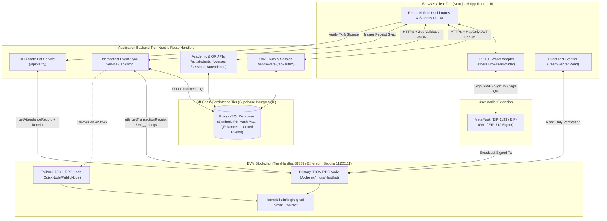
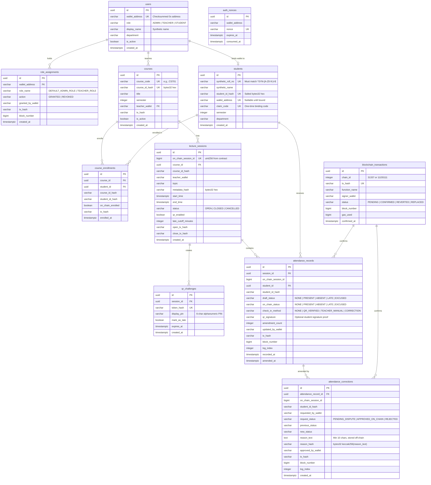
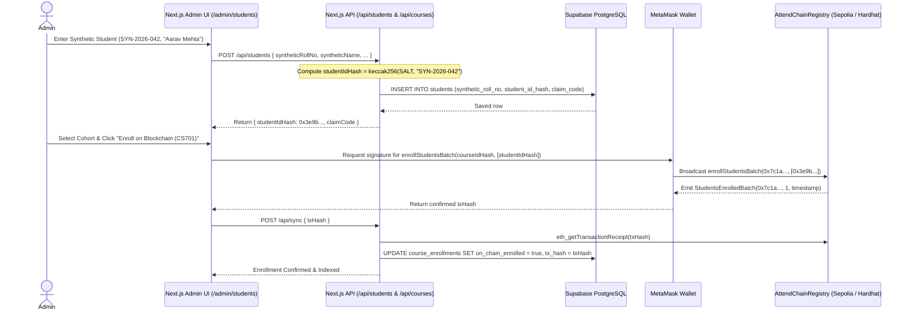
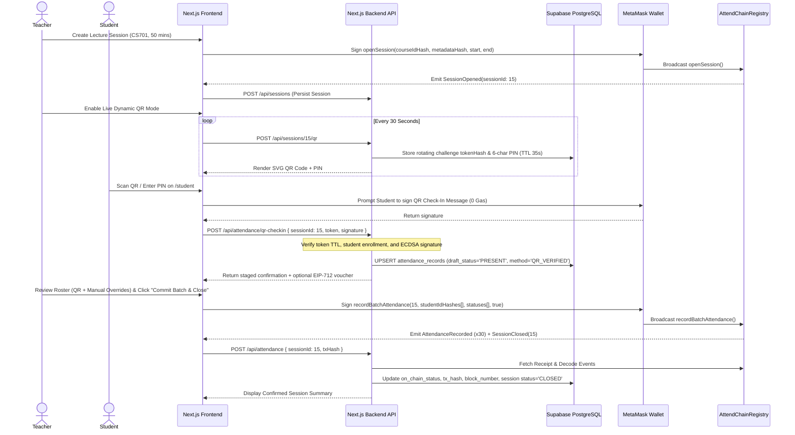
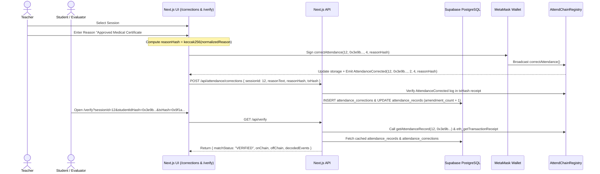

# 04_ARCHITECTURE.md — Architecture and Data Design

- **Purpose:** Document the end-to-end system architecture, component boundaries, explicit on-chain/off-chain data classification, PostgreSQL ERD and schema definitions, smart contract interface and event specifications, REST API contracts, sequence diagrams, transaction lifecycle, and scaling/retention rules for AttendChain.
- **Status:** Draft v1
- **Last updated:** 2026-10-13
- **Depends on:** `/docs/01_PRD.md`, `/docs/02_TRD.md`, `/docs/03_UIUX.md`

---

## 1. High-Level System Architecture

### 1.1 Component Responsibilities & Trust Boundaries

| Component | Core Responsibilities | Trust & Security Boundary |
| :--- | :--- | :--- |
| **Next.js Client UI** | Renders role dashboards, manages form state, displays QR codes, formats attendance percentages, and initiates wallet signing prompts. | **Untrusted Client:** UI role checks are for UX only; never trusted for authorization or data integrity. |
| **MetaMask (EIP-1193 Wallet)** | Holds user private keys, signs EIP-4361 SIWE authentication messages, signs off-chain QR check-in payloads, and signs/broadcasts on-chain transactions. | **User-Controlled Signer:** Proves cryptographic key ownership only when a valid signature is verified by the backend or EVM. |
| **Next.js API Routes** | Enforces SIWE session JWTs and RBAC, computes salted `studentIdHash` commitments, issues/validates 30-second QR challenges, and coordinates database reads/writes. | **Trusted Server Boundary:** Holds `SUPABASE_SERVICE_ROLE_KEY`, `AUTH_JWT_SECRET`, `INSTITUTION_HASH_SALT`, and `QR_TICKET_SIGNER_PRIVATE_KEY`. |
| **Supabase PostgreSQL** | Stores off-chain synthetic student profiles, `studentIdHash` mappings, SIWE nonces, rotating QR challenges, student dispute requests, and indexed blockchain events. | **Mutable Off-Chain Store:** Subject to tampering if server credentials are compromised; therefore audited against on-chain state via `/verify`. |
| **Event Sync Service** | Fetches transaction receipts and contract logs from RPC and idempotently updates PostgreSQL tables keyed by `(chain_id, tx_hash, log_index)`. | **Stateless Indexer:** Cannot invent on-chain state; only ingests confirmed logs from `AttendChainRegistry`. |
| **`AttendChainRegistry` Contract** | Enforces on-chain RBAC (`ADMIN`, `TEACHER`), course ownership, student enrollment (`studentIdHash`), session lifecycle (`OPEN`, `CLOSED`, `CANCELLED`), duplicate prevention, and immutable correction logs. | **Immutable Trust Anchor:** Source of truth for attendance statuses, timestamps, signers, and correction audit history. |

---

## 2. Explicit On-Chain vs. Off-Chain Data Classification

Per Non-Negotiable Principles #2, #4, #9, and #10, AttendChain enforces a strict separation between public blockchain state and private off-chain relational data:

| Data Element | Storage Location | On-Chain Representation | Justification & Privacy Analysis |
| :--- | :--- | :--- | :--- |
| **Student Name, Roll Number, Email, Department** | **Off-Chain Only** (`students` table) | `studentIdHash` (`bytes32`) = `keccak256(INSTITUTION_HASH_SALT, canonicalRollNo)` | Placing PII on Sepolia violates privacy regulations (e.g., India DPDP Act) because blockchain state cannot be erased. Salted hashing prevents rainbow-table reversal of predictable roll numbers (`SYN-2026-001`). |
| **Student Personal Wallet Address** | **Off-Chain Primary** (`students.wallet_address`) | Not required in `recordBatchAttendance`; only appears as `msg.sender` if student optionally uses direct `checkInWithTicket` | **Privacy Linkability Analysis:** If a contract keyed attendance by `address studentWallet`, anyone on Etherscan could correlate a student's personal wallet across every class they attended. Keying contract storage by `bytes32 studentIdHash` and defaulting QR check-ins to Teacher batch commits (`[ASSUMPTION: A-05]`) prevents public wallet-activity correlation. |
| **Teacher & Admin Wallet Addresses** | **Both On-Chain & Off-Chain** | `address` in `AccessControl` roles and `SessionOpened` / `AttendanceRecorded` events | Institutional role holders act in an official capacity; their signing addresses provide non-repudiation for session creation, marking, and corrections. |
| **Course Code & Title** | **Off-Chain Full Text** (`courses` table) | `courseIdHash` (`bytes32`) = `keccak256("CS701")` | Avoids expensive dynamic `string` storage on-chain while maintaining a deterministic 1-to-1 verifiable identifier. |
| **Lecture Topic & Schedule Notes** | **Off-Chain Full Text** (`lecture_sessions` table) | `metadataHash` (`bytes32`), `uint40 startTime`, `uint40 endTime`, `uint8 status` | Timestamps and session state (`OPEN`/`CLOSED`/`CANCELLED`) must be enforced by the EVM; descriptive text is hashed into `metadataHash`. |
| **Attendance Status (`PRESENT`, `ABSENT`, `LATE`, `EXCUSED`)** | **On-Chain Source of Truth** + **Off-Chain Indexed Cache** | `uint8 status` inside 32-byte packed `AttendanceRecord` struct + `AttendanceRecorded` event | Core evidentiary asset requiring tamper-evident storage and independent verification. |
| **Correction Reason & Dispute Explanation** | **Off-Chain Full Text** (`attendance_corrections` table) | `reasonHash` (`bytes32`) = `keccak256(normalizedReasonText)` in `AttendanceCorrected` event | Prevents accidental disclosure of sensitive medical/personal details in correction notes on a public chain while cryptographically binding the exact text via `reasonHash`. |
| **SIWE Nonces & Rotating 30s QR Challenges** | **Off-Chain Only** (`auth_nonces`, `qr_challenges` tables) | None (unless redeemed via EIP-712 `ticketNonce` in `checkInWithTicket`) | High-frequency, short-lived ephemeral coordination data (`30s`–`5m` TTL) that would waste gas on-chain. |

---

## 3. Entity-Relationship Diagram (PostgreSQL Off-Chain Schema)

### 3.1 Required Database Indexes & Constraints (`supabase/migrations/0001_initial_schema.sql`)
- `UNIQUE (on_chain_session_id, student_id_hash)` on `attendance_records` — guarantees one canonical status row per student per session.
- `UNIQUE (chain_id, tx_hash, log_index)` on an `indexed_contract_events` ledger table — enforces strict idempotency during event synchronization (`NFR-007`).
- `CHECK (synthetic_roll_no ~ '^SYN-[A-Z0-9-]+$')` on `students` — database-level guard preventing insertion of non-synthetic student roll numbers.
- Composite index `idx_attendance_student_course` on `attendance_records(student_id_hash, on_chain_session_id)` for $<50\text{ ms}$ percentage calculation queries.

---

## 4. Smart Contract Specification (`AttendChainRegistry.sol`)

### 4.1 On-Chain Enums & Packed Data Structures

- **`AttendanceStatus` Enum (`uint8`):** `0 = NONE`, `1 = PRESENT`, `2 = ABSENT`, `3 = LATE`, `4 = EXCUSED`.
- **`SessionStatus` Enum (`uint8`):** `0 = NONE`, `1 = OPEN`, `2 = CLOSED`, `3 = CANCELLED`.
- **`Course` Struct:**
  - `bytes32 courseIdHash`
  - `address assignedTeacher`
  - `bool exists`
  - `bool isActive`
- **`Session` Struct (Packed into 2 slots):**
  - `bytes32 courseIdHash` (32B — Slot 0)
  - `bytes32 metadataHash` (32B — Slot 1)
  - `address teacher` (20B — Slot 2)
  - `uint40 startTime` (5B — Slot 2)
  - `uint40 endTime` (5B — Slot 2)
  - `uint8 status` (1B — Slot 2: `SessionStatus`)
- **`AttendanceRecord` Struct (Packed into exactly 1 32-byte slot — `DEC-03`):**
  - `address updatedBy` (20 bytes)
  - `uint40 recordedAt` (5 bytes)
  - `uint40 amendedAt` (5 bytes)
  - `uint8 status` (1 byte: `AttendanceStatus`)
  - `uint8 amendmentCount` (1 byte: saturates at 255)

### 4.2 Contract Functions, Access Control & Custom Errors

| Function Signature | Caller Role | State Validations | Emitted Events |
| :--- | :--- | :--- | :--- |
| `grantTeacherRole(address teacher)` | `DEFAULT_ADMIN_ROLE` | `teacher != address(0)` | `RoleGranted`, `TeacherRoleUpdated` |
| `revokeTeacherRole(address teacher)` | `DEFAULT_ADMIN_ROLE` | `hasRole(TEACHER_ROLE, teacher)` | `RoleRevoked`, `TeacherRoleUpdated` |
| `setQrTicketSigner(address signer)` | `DEFAULT_ADMIN_ROLE` | `signer != address(0)` | `QrTicketSignerUpdated` |
| `createCourse(bytes32 courseIdHash, address teacher)` | `DEFAULT_ADMIN_ROLE` | `!courses[courseIdHash].exists`, `hasRole(TEACHER_ROLE, teacher)` | `CourseCreated` |
| `updateCourseTeacher(bytes32 courseIdHash, address newTeacher)` | `DEFAULT_ADMIN_ROLE` | `courses[courseIdHash].exists`, `hasRole(TEACHER_ROLE, newTeacher)` | `CourseTeacherUpdated` |
| `enrollStudentsBatch(bytes32 courseIdHash, bytes32[] calldata studentIdHashes)` | `DEFAULT_ADMIN_ROLE` | `courses[courseIdHash].exists`, `1 <= length <= 100` | `StudentsEnrolledBatch` |
| `openSession(bytes32 courseIdHash, bytes32 metadataHash, uint40 startTime, uint40 endTime)` | Assigned `teacher` or `DEFAULT_ADMIN_ROLE` | `courses[courseIdHash].isActive`, `endTime > startTime` | `SessionOpened` |
| `closeSession(uint256 sessionId)` | Assigned `teacher` or `DEFAULT_ADMIN_ROLE` | `sessions[sessionId].status == OPEN` | `SessionClosed` |
| `cancelSession(uint256 sessionId, bytes32 reasonHash)` | Assigned `teacher` or `DEFAULT_ADMIN_ROLE` | `sessions[sessionId].status == OPEN`, `reasonHash != bytes32(0)` | `SessionCancelled` |
| `recordBatchAttendance(uint256 sessionId, bytes32[] calldata studentIdHashes, uint8[] calldata statuses, bool closeAfter)` | Assigned `teacher` or `DEFAULT_ADMIN_ROLE` | `status == OPEN`, matching array lengths (`1..100`), each student enrolled in course, existing record `status == NONE`, each new status in `1..4` | `AttendanceRecorded` (per student), `AttendanceBatchCommitted`, optional `SessionClosed` |
| `checkInWithTicket(uint256 sessionId, bytes32 studentIdHash, uint8 status, uint256 deadline, bytes calldata serverSignature)` | Any caller with valid EIP-712 `QrCheckInTicket` signed by `qrTicketSigner` | `session == OPEN`, `block.timestamp <= deadline`, student enrolled, existing record `status == NONE`, `status` is `PRESENT` or `LATE` | `AttendanceRecorded` |
| `correctAttendance(uint256 sessionId, bytes32 studentIdHash, uint8 newStatus, bytes32 reasonHash)` | Assigned `teacher` or `DEFAULT_ADMIN_ROLE` | `sessions[sessionId].status == CLOSED`, existing record `status != NONE`, `newStatus != existing.status`, `newStatus in 1..4`, `reasonHash != bytes32(0)` | `AttendanceCorrected` |
| `getAttendanceRecord(uint256 sessionId, bytes32 studentIdHash)` | `view` (Public) | None | Returns `AttendanceRecord` struct |

### 4.3 Custom Solidity Errors
- `InvalidAddress()`
- `InvalidTeacherRole(address candidate)`
- `CourseAlreadyExists(bytes32 courseIdHash)`
- `CourseNotFound(bytes32 courseIdHash)`
- `UnauthorizedCourseTeacher(bytes32 courseIdHash, address caller)`
- `ArrayLengthMismatch(uint256 studentsLength, uint256 statusesLength)`
- `BatchSizeExceeded(uint256 provided, uint256 maxAllowed)`
- `StudentNotEnrolled(bytes32 courseIdHash, bytes32 studentIdHash)`
- `SessionNotOpen(uint256 sessionId, uint8 currentStatus)`
- `SessionNotClosed(uint256 sessionId, uint8 currentStatus)`
- `InvalidTimeWindow(uint40 startTime, uint40 endTime)`
- `InvalidAttendanceStatus(uint8 status)`
- `AttendanceAlreadyRecorded(uint256 sessionId, bytes32 studentIdHash)`
- `AttendanceNotYetRecorded(uint256 sessionId, bytes32 studentIdHash)`
- `IdenticalAttendanceStatus(uint8 currentStatus)`
- `EmptyCorrectionReason()`
- `ExpiredQrTicket(uint256 deadline, uint256 currentTimestamp)`
- `InvalidQrTicketSignature()`

### 4.4 Contract Event Specifications
- `event CourseCreated(bytes32 indexed courseIdHash, address indexed teacher, uint40 timestamp);`
- `event StudentsEnrolledBatch(bytes32 indexed courseIdHash, uint256 count, uint40 timestamp);`
- `event SessionOpened(uint256 indexed sessionId, bytes32 indexed courseIdHash, address indexed teacher, uint40 startTime, uint40 endTime, bytes32 metadataHash);`
- `event SessionClosed(uint256 indexed sessionId, address indexed closedBy, uint40 timestamp);`
- `event SessionCancelled(uint256 indexed sessionId, address indexed cancelledBy, bytes32 reasonHash, uint40 timestamp);`
- `event AttendanceRecorded(uint256 indexed sessionId, bytes32 indexed studentIdHash, uint8 status, address indexed recordedBy, uint40 timestamp);`
- `event AttendanceBatchCommitted(uint256 indexed sessionId, uint256 studentCount, address indexed committedBy, bool sessionClosed, uint40 timestamp);`
- `event AttendanceCorrected(uint256 indexed sessionId, bytes32 indexed studentIdHash, uint8 previousStatus, uint8 newStatus, bytes32 reasonHash, address indexed correctedBy, uint8 amendmentCount, uint40 timestamp);`

---

## 5. Backend REST API Contracts

All API endpoints accept and return `application/json`, validate inputs with `zod`, and return standard error payloads `{ error: { code: string, message: string, details?: unknown } }`.

| Method & Path | Auth / Role | Request Schema (Zod Summary) | Response Schema (`200`/`201`) | Validation & Error Codes |
| :--- | :--- | :--- | :--- | :--- |
| `POST /api/auth/nonce` | Public | `{ walletAddress: z.string().regex(/^0x[a-fA-F0-9]{40}$/) }` | `{ nonce: string, message: string, expiresAt: string }` | `400 INVALID_ADDRESS`, `429 RATE_LIMITED` |
| `POST /api/auth/verify` | Public | `{ walletAddress: string, message: string, signature: string, studentClaimCode?: string }` | `{ user: { walletAddress, role, displayName, studentIdHash? } }` + sets `HttpOnly` cookie `attendchain_session` | `401 INVALID_SIGNATURE`, `401 NONCE_EXPIRED`, `401 NONCE_ALREADY_USED`, `404 UNREGISTERED_WALLET` |
| `POST /api/auth/logout` | Any Authenticated | `{}` | `{ success: true }` + clears `attendchain_session` cookie | `200 OK` |
| `GET /api/roles` | `ADMIN` | Query: `?role=TEACHER_ROLE` | `{ roles: RoleAssignment[] }` | `401 UNAUTHORIZED`, `403 FORBIDDEN` |
| `POST /api/roles` | `ADMIN` | `{ walletAddress: string, displayName: string, department: string, roleName: "TEACHER_ROLE" \| "DEFAULT_ADMIN_ROLE", action: "GRANTED" \| "REVOKED", txHash: string }` | `{ roleAssignment: RoleAssignment }` | Verifies `txHash` receipt on RPC before persisting; `400 TX_VERIFICATION_FAILED` |
| `GET /api/students` | `ADMIN`, `TEACHER` | Query: `?courseId=...` | `{ students: StudentProfile[] }` | `401`, `403` |
| `POST /api/students` | `ADMIN` | `{ syntheticRollNo: z.string().regex(/^SYN-[A-Z0-9-]+$/), syntheticName: string, department: string, semester: number, walletAddress?: string }` | `{ student: { id, syntheticRollNo, studentIdHash, claimCode } }` | `400 NON_SYNTHETIC_ROLL_REJECTED`, `409 DUPLICATE_STUDENT` |
| `GET /api/courses` | `ADMIN`, `TEACHER`, `STUDENT` | Query: `?teacherWallet=...` | `{ courses: CourseWithMetrics[] }` | Filters to enrolled/assigned courses for Student/Teacher |
| `POST /api/courses` | `ADMIN` | `{ courseCode: string, title: string, semester: number, teacherWallet: string, txHash: string, enrollStudentHashes?: string[] }` | `{ course: Course }` | `400 INVALID_TEACHER`, `409 COURSE_EXISTS` |
| `GET /api/sessions` | Authenticated | Query: `?courseId=...&status=OPEN` | `{ sessions: LectureSession[] }` | `200 OK` |
| `POST /api/sessions` | `TEACHER`, `ADMIN` | `{ courseId: string, onChainSessionId: number, topic: string, metadataHash: string, startTime: string, endTime: string, openTxHash: string }` | `{ session: LectureSession }` | `403 NOT_COURSE_TEACHER`, `400 INVALID_WINDOW` |
| `POST /api/sessions/[sessionId]/qr` | `TEACHER`, `ADMIN` | `{ markAsLate?: boolean }` | `{ qrPayload: string, displayPin: string, expiresAt: string, ttlSeconds: 30 }` | `400 SESSION_NOT_OPEN`, `403 FORBIDDEN` |
| `POST /api/attendance/qr-checkin` | `STUDENT` | `{ sessionId: string, tokenOrPin: string, signature: string, signedTimestamp: number }` | `{ checkIn: { status: "PRESENT" \| "LATE", staged: true, eip712Ticket: { deadline, serverSignature } } }` | `400 QR_TOKEN_EXPIRED`, `403 NOT_ENROLLED`, `409 ALREADY_CHECKED_IN` |
| `GET /api/attendance` | Authenticated | Query: `?sessionId=...&studentIdHash=...&courseId=...` | `{ records: AttendanceRecordView[], metrics: AttendancePercentageMetrics }` | Students can only query their own `studentIdHash` (`403` otherwise) |
| `POST /api/attendance` | `TEACHER`, `ADMIN` | `{ sessionId: string, txHash: string, records: { studentIdHash: string, status: string }[], closeSession: boolean }` | `{ syncedCount: number, txHash: string, sessionStatus: string }` | Triggers receipt verification & sync (`TR-011`) |
| `POST /api/attendance/corrections` | `STUDENT` (request) / `TEACHER`, `ADMIN` (execute) | Request: `{ sessionId, reasonText, requestedStatus }` OR Execute: `{ sessionId, studentIdHash, newStatus, reasonText, reasonHash, txHash }` | `{ correction: AttendanceCorrection }` | Enforces `reasonText.length >= 10` and `keccak256(reasonText) == reasonHash` |
| `POST /api/sync` | Authenticated | `{ txHash?: string, fromBlock?: number }` | `{ processedEvents: number, latestSyncedBlock: number }` | Idempotent log processor (`TR-011`) |
| `GET /api/verify` | Public | Query: `?txHash=0x...&sessionId=15&studentIdHash=0x...` | `{ verified: boolean, matchStatus: "VERIFIED" \| "MISMATCH" \| "NOT_FOUND", onChain: OnChainState, offChain: OffChainState, decodedEvents: DecodedEvent[] }` | Queries RPC directly (`TR-012`); `503 RPC_UNAVAILABLE` if both RPCs down |

---

## 6. Sequence Diagrams for Main User Journeys

### 6.1 Sequence 1: Admin Privacy-Preserving Student Registration & Cohort Enrollment

### 6.2 Sequence 2: Teacher Session Creation, Dynamic QR Check-In, and Batch On-Chain Commit

### 6.3 Sequence 3: Auditable Attendance Correction & Independent Verification

---

## 7. Transaction Lifecycle, Idempotency, Reorgs, and Event Synchronization

### 7.1 Five-State Transaction Lifecycle
Every blockchain write operation in AttendChain transitions deterministically through:
1. **`SUBMITTED_TO_WALLET`:** UI invokes `contract.method(...)`; awaits user signature in MetaMask.
2. **`PENDING_IN_MEMPOOL`:** User approves; `tx.hash` returned. Saved immediately in `sessionStorage` (`attendchain_pending_txs`) and `blockchain_transactions` (`status = 'PENDING'`) so page reloads never orphan an in-flight transaction (`FR-022`).
3. **`CONFIRMED`:** `tx.wait(confirmations)` resolves (`1` confirmation on local Hardhat `31337`; `1` confirmation for immediate UI feedback on Sepolia `11155111` followed by background verification at `2` confirmations).
4. **`REVERTED`:** Transaction receipt returns `status === 0` or `estimateGas` reverts with a custom error. Decoded via `contract.interface.parseError(err.data)` and logged as `status = 'REVERTED'`.
5. **`REPLACED`:** User clicks "Speed Up" or "Cancel" in MetaMask (`ethers` throws `TRANSACTION_REPLACED` with `err.replacement.hash`). The client automatically updates the tracked `txHash` to `err.replacement.hash` if `err.reason === 'repriced'`, or marks cancelled if `err.cancelled === true`.

### 7.2 Idempotency & Reorganization Safety (`NFR-007`)
- **Idempotent Log Ingestion:** Every contract event processed by `/api/sync` is uniquely identified by `(chain_id, tx_hash, log_index)`. Re-running `/api/sync` over the same transaction receipt or block range executes `INSERT ... ON CONFLICT (chain_id, tx_hash, log_index) DO NOTHING`, ensuring zero duplicate state mutations.
- **Shallow Reorg Handling on Sepolia:** When `/api/sync` performs block-range polling, it queries from `Math.max(deploymentBlock, lastSyncedBlock - 3)` (re-scanning a 3-block safety window) and cross-checks `getAttendanceRecord(sessionId, studentIdHash)` directly on-chain before committing final status updates.

---

## 8. Data Retention, Privacy Erasure, Scaling Limits & Architecture Trade-Offs

### 8.1 Data Retention & Right-to-Erasure Behaviour
- Because on-chain hashes (`studentIdHash`, `reasonHash`) cannot be deleted from Ethereum Sepolia, AttendChain achieves **Cryptographic Unlinkability on Erasure**:
  - If a student exercises a data deletion request (or when a cohort is purged post-evaluation), deleting the row in the off-chain `students` table (or rotating/destroying `INSTITUTION_HASH_SALT`) permanently severs the link between the student's identity and the on-chain `bytes32 studentIdHash`, rendering the remaining on-chain bytes anonymous random numbers.
- Ephemeral tables (`auth_nonces` and `qr_challenges`) are purged automatically for rows older than `24 hours`.

### 8.2 Scaling Limits & Failure Modes
- **Batch Size Ceiling:** `recordBatchAttendance` and `enrollStudentsBatch` enforce `MAX_BATCH_SIZE = 100` per transaction (~`1.5M–2.8M gas`). Cohorts of 101–300 students are automatically split into sequential chunks of 100 by the frontend transaction coordinator.
- **Database Outage Mode:** If Supabase is temporarily unreachable, the `/verify` page continues to function in **Direct-to-RPC Stateless Mode**, reading `getAttendanceRecord` and transaction receipts directly from Sepolia RPC.
