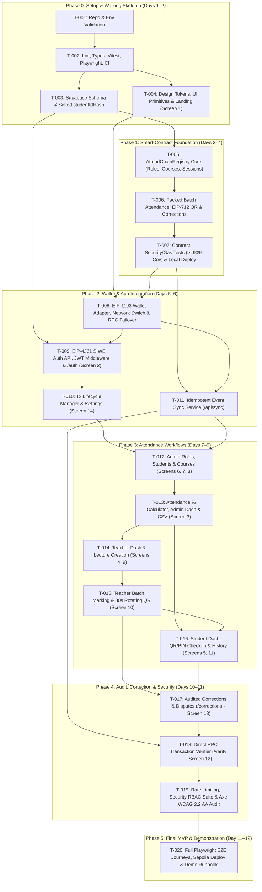

# 08_PHASES.md — Development Roadmap & Phase Gates

- **Purpose:** Define the dependency-aware 6-phase implementation roadmap (`Phase 0` through `Phase 5`), effort feasibility analysis (focused development days vs. elapsed calendar days), measurable phase exit gates, phase demo scripts, and MVP boundary for AttendChain.
- **Status:** Draft v1
- **Last updated:** 2026-10-13
- **Depends on:** `/docs/01_PRD.md`, `/docs/02_TRD.md`, `/docs/03_UIUX.md`, `/docs/04_ARCHITECTURE.md`, `/docs/05_SECURITY.md`, `/docs/06_TICKETS.md`, `/docs/07_RULES.md`

---

## 1. Timeline Feasibility Assessment: Focused Development Days vs. Calendar Days

The project brief establishes a **12-day initial MVP target** for a single primary student developer assisted by AI coding agents.

| Metric | Estimate | Breakdown & Rationale |
| :--- | :--- | :--- |
| **Focused AI-Assisted Development Time** | **10.0 Focused Days** (~60–70 focused engineering hours across 20 tickets) | Each `S`/`M`/`L` ticket in `06_TICKETS.md` is scoped to a single 2.5–4 hour focused session. Using a single unified repository (Next.js App Router + Hardhat + Supabase SQL) avoids multi-repo orchestration overhead. |
| **Buffer for Testnet Ops & Phase Gate Reviews** | **2.0 Calendar Days** | Accounts for Ethereum Sepolia testnet faucet acquisition, Etherscan contract verification propagation, and 6 user checkpoint approvals (`Phase 0`–`Phase 5`). |
| **Total Elapsed Calendar Timeline** | **12.0 Calendar Days** | **Feasible within the 12-day target** provided the scope lock in Section 9 is strictly maintained and local development uses the instant-mining Hardhat network (`31337`) prior to Phase 5 Sepolia deployment. |

### Schedule Summary Table

| Phase | Phase Name | Tickets | Focused Dev Effort | Calendar Window | Cumulative Progress |
| :--- | :--- | :--- | :--- | :--- | :--- |
| **Phase 0** | Setup and Walking Skeleton | `T-001`, `T-002`, `T-003`, `T-004` | `1.5 Days` (10h) | Day 1 – Day 2 (AM) | App shell live, DB schema migrated, CI/tests running |
| **Phase 1** | Smart-Contract Foundation | `T-005`, `T-006`, `T-007` | `2.0 Days` (14h) | Day 2 (PM) – Day 4 | `AttendChainRegistry.sol` 100% tested ($\ge 90\%$ branch cov) & deployed locally |
| **Phase 2** | Wallet & Application Integration | `T-008`, `T-009`, `T-010`, `T-011` | `2.0 Days` (14h) | Day 5 – Day 6 | MetaMask + SIWE auth, RPC failover, tx lifecycle, idempotent event sync |
| **Phase 3** | Attendance Workflows | `T-012`, `T-013`, `T-014`, `T-015`, `T-016` | `2.5 Days` (18h) | Day 7 – Day 9 | Admin setup, Teacher batch + 30s Dynamic QR, Student check-in & % dashboard |
| **Phase 4** | Audit, Correction & Security | `T-017`, `T-018`, `T-019` | `1.5 Days` (10h) | Day 10 – Day 11 (AM) | On-chain corrections, `/verify` RPC tamper detector, RBAC & WCAG 2.2 AA audit |
| **Phase 5** | Final MVP & Demonstration | `T-020` | `0.5 Days` (4h) + `1.5d` Buffer | Day 11 (PM) – Day 12 | Full E2E suite, Ethereum Sepolia deployment & Etherscan verification, live demo |

---

## 2. Mermaid Ticket & Phase Dependency Diagram

---

## 3. Phase 0 — Setup and Walking Skeleton

- **Goal & Rationale:** Establish a working, type-safe Next.js 15 + Hardhat 2.29 + Supabase skeleton with verified dependencies, strict environment validation, PII-redacting logger, database schema migrations, and an accessible Landing Page (`Screen 1`) before writing any blockchain or business logic.
- **Ticket IDs:** `T-001`, `T-002`, `T-003`, `T-004`
- **Dependencies:** None
- **Deliverables:**
  - Locked `package.json` and `package-lock.json` matching `02_TRD.md` and `07_RULES.md`.
  - `src/lib/validation/env.ts` and `src/lib/logger.ts` with PII/secret redaction.
  - `supabase/migrations/0001_initial_schema.sql`, `supabase/seed.sql`, and `src/lib/attendance/identity.ts` (`computeStudentIdHash`).
  - Responsive `Screen 1: Landing Page` (`/`) with design tokens and accessible UI primitives.
- **Measurable Exit Criteria:**
  1. `npm run lint`, `npm run format:check`, `npm run typecheck`, and `npm run build` exit with code `0`.
  2. `npm run test:unit` passes `100%` of tests for `env.ts`, `logger.ts`, and `identity.ts`.
  3. Playwright + `@axe-core/playwright` scan on `/` passes with `0` critical or serious WCAG 2.2 AA violations.
- **Test Plan:** Execute `npm run lint && npm run typecheck && npm run test:unit && npm run build && npx playwright test tests/e2e/landing.spec.ts`.
- **Demo Script:**
  1. Start local server (`npm run dev`) and open `http://localhost:3000`.
  2. Inspect the Landing Page across desktop (`1280px`) and mobile (`375px`) viewports; verify keyboard `Tab` focus rings.
  3. Run `npx vitest run tests/unit/identity.test.ts` to demonstrate deterministic salted `studentIdHash` generation for `SYN-2026-042` and rejection of non-synthetic roll numbers.
- **Security Checks:** Verify `.gitignore` blocks `.env*` secrets; verify `logger.ts` strips `privateKey` and `rollNumber`; verify no real student data exists in `seed.sql`.
- **Risks & Effort:** Low risk; `1.5 Focused Days` (`2.0 Calendar Days`).

---

## 4. Phase 1 — Smart-Contract Foundation

- **Goal & Rationale:** Build, test, and locally deploy `AttendChainRegistry.sol` with 100% of role access controls, course/student hash enrollments, session lifecycle states (`OPEN`, `CLOSED`, `CANCELLED`), single-slot 32-byte packed `AttendanceRecord` structs, EIP-712 `checkInWithTicket` verification, and auditable `correctAttendance` events verified prior to UI integration.
- **Ticket IDs:** `T-005`, `T-006`, `T-007`
- **Dependencies:** Phase 0 approved (`T-001`–`T-004`)
- **Deliverables:**
  - `blockchain/contracts/AttendChainRegistry.sol` compiled with Solidity `0.8.28`.
  - `blockchain/test/AttendChainRegistry.test.ts` with $\ge 95\%$ statement coverage and $\ge 90\%$ branch coverage.
  - Local deployment module (`blockchain/ignition/modules/AttendChainRegistry.ts`) and seed script (`blockchain/scripts/deploy-and-seed.ts`).
- **Measurable Exit Criteria:**
  1. `npm run contracts:compile` completes with `0` errors and `0` warnings.
  2. `npm run test:contracts:coverage` achieves $\ge 95\%$ statement coverage and $\ge 90\%$ branch coverage (`NFR-008`).
  3. Hardhat gas reporter confirms `recordBatchAttendance` for 50 students consumes $\le 1,500,000\text{ gas}$ (`NFR-004`).
  4. Calldata inspection test confirms `0` plaintext PII strings exist in contract storage or events (`NFR-001`).
- **Test Plan:** Execute `npm run test:contracts` with `REPORT_GAS=true` and `npm run test:contracts:coverage`.
- **Demo Script:**
  1. Start local Hardhat node (`npx hardhat node`) in terminal 1.
  2. Run `npm run contracts:deploy:local` in terminal 2 to deploy `AttendChainRegistry` and seed synthetic courses/students on-chain.
  3. Run `npm run test:contracts` to display passing access control, duplicate prevention, EIP-712 ticket check-in, and correction audit tests along with the gas report table.
- **Security Checks:** Verify all unauthorized role calls revert with custom errors; verify `correctAttendance` reverts on `OPEN` sessions or empty `reasonHash`; verify `MAX_BATCH_SIZE = 100` cap reverts on 101 items.
- **Risks & Effort:** Medium risk (EIP-712 struct hashing and 32-byte slot packing); `2.0 Focused Days` (`2.0 Calendar Days`).

---

## 5. Phase 2 — Wallet and Application Integration

- **Goal & Rationale:** Connect the Next.js application to MetaMask and the deployed smart contract with cryptographic SIWE authentication (`FR-002`), automatic wrong-network detection and switching (`FR-021`), primary/fallback RPC failover (`FR-022`), persistent transaction lifecycle tracking, and idempotent event synchronization (`NFR-007`).
- **Ticket IDs:** `T-008`, `T-009`, `T-010`, `T-011`
- **Dependencies:** Phase 1 approved (`T-005`–`T-007`)
- **Deliverables:**
  - Wallet Provider Adapter (`src/lib/blockchain/wallet.tsx`) and RPC Failover Wrapper (`src/lib/blockchain/provider.ts`).
  - SIWE Auth endpoints (`/api/auth/nonce`, `/api/auth/verify`, `/api/auth/logout`), `src/middleware.ts`, and `Screen 2: /auth`.
  - Transaction Lifecycle Manager (`src/lib/blockchain/tx-manager.ts`), `TxLifecycleBanner.tsx`, and `Screen 14: /settings`.
  - Idempotent Event Sync Service (`src/lib/blockchain/sync.ts` and `POST /api/sync`).
- **Measurable Exit Criteria:**
  1. Connecting MetaMask without signing the SIWE message returns `401 Unauthorized` on all protected APIs and redirects protected pages to `/auth`.
  2. Signing the SIWE message logs the user in; replaying the same nonce signature returns `401 NONCE_ALREADY_USED`.
  3. Switching MetaMask to Ethereum Mainnet (`chainId: 1`) immediately displays `NetworkBanner` and disables write buttons; clicking "Switch Network" switches back to Hardhat (`31337`) or Sepolia (`11155111`).
  4. Running `POST /api/sync` 3 times over the same block range produces `0` duplicate rows in Supabase (`NFR-007`).
- **Test Plan:** Execute `npx vitest run tests/unit/rpc-failover.test.ts tests/unit/tx-manager.test.ts tests/integration/auth-siwe.test.ts tests/integration/event-sync.test.ts`.
- **Demo Script:**
  1. Open `/auth`, connect MetaMask, and attempt to visit `/admin` before signing $\rightarrow$ demonstrate redirect back to `/auth`.
  2. Click "Sign Authentication Challenge", approve in MetaMask, and demonstrate authenticated session redirect.
  3. Open `/settings` (`Screen 14`), inspect active chain ID, contract address, primary/fallback RPC latency, and trigger "Force Re-Sync Contract Events".
- **Security Checks:** Verify `attendchain_session` cookie has `HttpOnly` and `SameSite=Lax`; verify expired (>5m) and replayed nonces are rejected.
- **Risks & Effort:** Medium risk (browser wallet state edge cases); `2.0 Focused Days` (`2.0 Calendar Days`).

---

## 6. Phase 3 — Attendance Workflows

- **Goal & Rationale:** Deliver the complete end-to-end classroom attendance experience across Admin, Teacher, and Student personas: role grants, privacy-preserving student registration, course creation, lecture session opening, 30-second rotating Dynamic QR check-in, gas-efficient batch attendance commits, and exact attendance percentage tracking.
- **Ticket IDs:** `T-012`, `T-013`, `T-014`, `T-015`, `T-016`
- **Dependencies:** Phase 2 approved (`T-008`–`T-011`)
- **Deliverables:**
  - Admin workspace screens: `Screen 3 (/admin)`, `Screen 6 (/admin/students)`, `Screen 7 (/admin/roles)`, `Screen 8 (/admin/courses)` + CSV export (`FR-020`).
  - Teacher workspace screens: `Screen 4 (/teacher)`, `Screen 9 (/teacher/lectures/new)`, `Screen 10 (/teacher/attendance/[sessionId])` with `DynamicQrProjector` and `RosterTable`.
  - Student workspace screens: `Screen 5 (/student)` with QR/PIN check-in card and `PercentageGaugeCard`, plus `Screen 11 (/student/history)`.
  - Pure attendance percentage calculator (`src/lib/attendance/calculator.ts`).
- **Measurable Exit Criteria:**
  1. Admin can grant `TEACHER_ROLE`, register synthetic student `SYN-2026-042` (`studentIdHash`), create course `CS701`, and batch-enroll students on-chain.
  2. Assigned Teacher can open a lecture session (`openSession`), project a rotating 30-second QR code/PIN, receive a live student wallet-signed QR check-in, mark remaining students manually, and commit the batch (`recordBatchAttendance`) in under 90 seconds (`G-03`).
  3. Student dashboard and history views display attendance percentage matching `calculateAttendanceMetrics` to 2 decimal places (`100%` unit test coverage on `calculator.ts`).
- **Test Plan:** Execute `npx vitest run tests/unit/calculator.test.ts tests/unit/qr-token.test.ts tests/integration/admin-apis.test.ts tests/integration/sessions-api.test.ts tests/integration/student-checkin.test.ts`.
- **Demo Script:**
  1. Log in as Admin $\rightarrow$ register `SYN-2026-042` on `/admin/students` (show live `bytes32 studentIdHash` preview) and enroll in `CS701`.
  2. Switch to Teacher wallet $\rightarrow$ open Lecture #15 on `/teacher/lectures/new` $\rightarrow$ activate Live Dynamic QR on `/teacher/attendance/15`.
  3. In a Student session, enter the 6-character rotating QR PIN on `/student` and sign the check-in message $\rightarrow$ watch the student's status flip to `PRESENT (QR Verified)` on the Teacher's roster.
  4. Teacher clicks "Commit Batch Attendance & Close Session" and confirms in MetaMask $\rightarrow$ Student refreshes `/student` and `/student/history` to see updated attendance percentage and confirmed `txHash`.
- **Security Checks:** Verify `POST /api/students` rejects non-`SYN-` roll numbers; verify expired (>35s) QR tokens are rejected; verify Student A cannot query Student B's attendance records.
- **Risks & Effort:** Medium-High effort (largest UI surface area — 9 screens); `2.5 Focused Days` (`3.0 Calendar Days`).

---

## 7. Phase 4 — Audit, Correction, and Security

- **Goal & Rationale:** Complete the governance, auditability, and trustless verification loop by enabling auditable on-chain attendance corrections (`correctAttendance` with mandatory `reasonHash`), student dispute requests, direct-to-RPC transaction and storage verification (`/verify`), rate limiting, and full WCAG 2.2 AA accessibility validation.
- **Ticket IDs:** `T-017`, `T-018`, `T-019`
- **Dependencies:** Phase 3 approved (`T-012`–`T-016`)
- **Deliverables:**
  - `Screen 13: Correction & Dispute History` (`/corrections`) + `/api/attendance/corrections`.
  - `Screen 12: Independent Transaction Verification` (`/verify`) + `/api/verify` (`src/lib/blockchain/verify.ts`).
  - Rate limiter (`src/lib/auth/rate-limit.ts`), CSP headers, RBAC penetration test suite (`tests/integration/security-rbac.test.ts`), and `@axe-core/playwright` 14-screen accessibility suite (`tests/e2e/accessibility.spec.ts`).
- **Measurable Exit Criteria:**
  1. Submitting an on-chain correction (`ABSENT -> EXCUSED`) on a `CLOSED` session emits `AttendanceCorrected` with `reasonHash`, updates the student's attendance percentage, and keeps both the original `AttendanceRecorded` event and the `AttendanceCorrected` event visible in `/corrections`.
  2. `/verify` compares Supabase records against live blockchain RPC state (`getAttendanceRecord` + transaction receipt) and immediately detects simulated database tampering with a red `DATA INTEGRITY MISMATCH` alert (`FR-014`).
  3. 100% of write API endpoints reject unauthorized roles in `security-rbac.test.ts`, and all 14 routes pass `accessibility.spec.ts` with `0` critical/serious axe violations (`NFR-006`).
- **Test Plan:** Execute `npx vitest run tests/integration/corrections.test.ts tests/integration/verify-tamper.test.ts tests/integration/security-rbac.test.ts` and `npx playwright test tests/e2e/accessibility.spec.ts`.
- **Demo Script:**
  1. Student submits a dispute request on `/student/history` for a closed session where they were marked `ABSENT`.
  2. Teacher opens `/corrections`, reviews the dispute, enters reason `"Approved Medical Certificate #MC-104"`, and executes `correctAttendance` on-chain $\rightarrow$ show both original and amended events in the audit log.
  3. Open `/verify` for that record $\rightarrow$ demonstrate `CRYPTOGRAPHICALLY VERIFIED` status against the RPC node.
  4. Temporarily alter the database status in Supabase Studio without a blockchain tx and click "Verify On-Chain" again $\rightarrow$ demonstrate that AttendChain catches the tampering (`DATA INTEGRITY MISMATCH DETECTED`), then restore via `/api/sync`.
- **Security Checks:** Verify all Phase 4 checks in `05_SECURITY.md` Section 12 pass.
- **Risks & Effort:** Low-Medium risk; `1.5 Focused Days` (`1.5 Calendar Days`).

---

## 8. Phase 5 — Final MVP and Demonstration

- **Goal & Rationale:** Execute end-to-end automated Playwright verification of all 4 user journeys, deploy and verify `AttendChainRegistry.sol` on Ethereum Sepolia testnet (`chainId: 11155111`), seed synthetic demonstration cohorts on Sepolia, and finalize the academic evaluation runbook.
- **Ticket IDs:** `T-020`
- **Dependencies:** Phase 4 approved (`T-017`–`T-019`)
- **Deliverables:**
  - Full Playwright E2E test suite (`tests/e2e/journeys.spec.ts`).
  - Verified Ethereum Sepolia contract deployment (`deployments/sepolia.json`) with Sepolia Etherscan source code verification.
  - Complete `README.md` with setup instructions, architecture summary, live evaluation demo script, and known prototype limitations.
- **Measurable Exit Criteria:**
  1. All quality gates pass: `npm run lint`, `npm run typecheck`, `npm run test:contracts:coverage` ($\ge 90\%$ branch), `npm run test:coverage` ($\ge 90\%$ core lib), `npm run build`, and `npm run test:e2e`.
  2. `AttendChainRegistry` is deployed to Ethereum Sepolia (`11155111`), verified on `sepolia.etherscan.io`, and the `/verify` page links directly to confirmed Sepolia transactions.
  3. `npm audit --audit-level=high` reports `0` high/critical vulnerabilities.
- **Test Plan:** Run the full CI verification pipeline end to end.
- **Demo Script (Final Academic Evaluation — 5-Minute Walkthrough):**
  1. **Minute 1 (Privacy & Onboarding):** Show Admin dashboard on Sepolia (`/admin/students`), highlight how synthetic student `SYN-2026-042` is hashed into `bytes32 studentIdHash` so zero PII appears on Sepolia Etherscan.
  2. **Minute 2 (Live Session & Dynamic QR):** As Teacher, open a lecture session on `/teacher/lectures/new` and project the 30-second rotating QR code + 6-character PIN on `/teacher/attendance/[sessionId]`.
  3. **Minute 3 (Student QR Check-In & Batch Commit):** As Student, check in with the rotating PIN and wallet signature; as Teacher, review the roster and commit all students in a single gas-efficient `recordBatchAttendance` transaction.
  4. **Minute 4 (Auditable Correction):** Execute an on-chain correction (`ABSENT -> EXCUSED`) on `/corrections` with a mandatory reason and show that both the original record and the amendment are permanently preserved.
  5. **Minute 5 (Trustless Verification):** Open `/verify`, verify the record directly against Ethereum Sepolia RPC, and click through to Sepolia Etherscan to show the raw `AttendanceRecorded` and `AttendanceCorrected` event logs containing only pseudonymous `bytes32` commitments.
- **Security Checks:** Confirm zero private keys or non-synthetic PII exist anywhere in git history or Sepolia transactions.
- **Risks & Effort:** `0.5 Focused Days` + `1.5 Days` Sepolia & review buffer (`2.0 Calendar Days`).

---

## 9. MVP Boundary vs. Post-MVP Backlog Summary

| Capability | Included in 12-Day MVP (Phases 0–5) | Deferred to Post-MVP Backlog |
| :--- | :--- | :--- |
| **Smart Contract & Networks** | `AttendChainRegistry.sol` on Local Hardhat (`31337`) & Ethereum Sepolia (`11155111`) | L2 Rollup deployment (Arbitrum/Base) & ERC-4337 Account Abstraction Paymaster |
| **Authentication & Roles** | MetaMask EIP-1193 + EIP-4361 SIWE + OpenZeppelin `AccessControl` (`ADMIN`, `TEACHER`, `STUDENT`) | Multi-sig `Safe` admin governance & university SSO (OAuth/SAML) integration |
| **Attendance Capture** | Teacher Manual/Batch Marking (`recordBatchAttendance`) + 30s Rotating Dynamic QR/PIN (`checkInWithTicket` & gasless staging) | Native mobile app with hardware geofencing / Bluetooth beacon attestation |
| **Privacy Architecture** | Salted `bytes32 studentIdHash` + `bytes32 reasonHash`; 100% synthetic PII kept off-chain in Supabase | Zero-knowledge proof (zk-SNARK) anonymous credential check-ins |
| **Verification & Audit** | Direct RPC vs. DB state diff verifier (`/verify`), chronological event log, CSV shortage export | Dedicated The Graph subgraph cluster & automated email/SMS shortage notifications |
